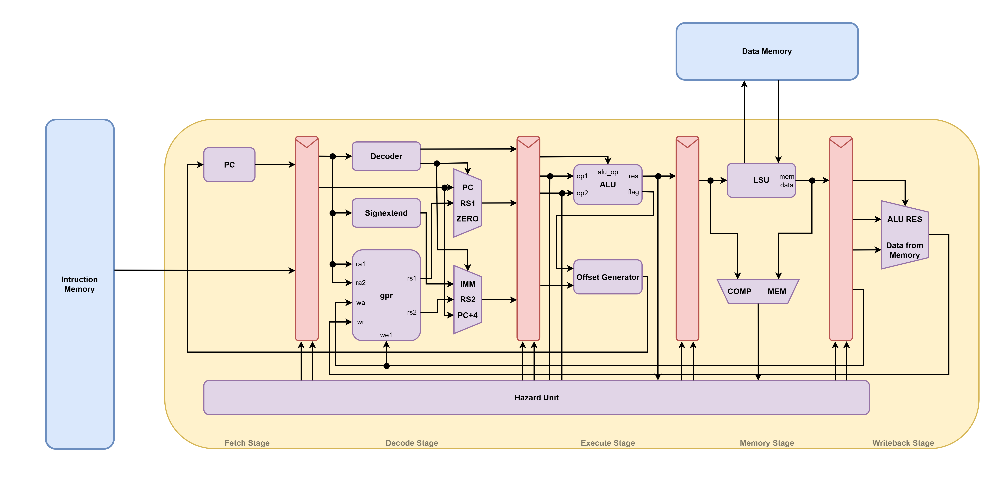

# MIST
The development of this processor core was inspired by the "[Architectures of Computing Systems](https://github.com/MPSU/APS/tree/english_version)" (APS) course taught at MIET, as well as by an open-source core [MIRISCV](https://github.com/MPSU/MIRISCV).



## Main features
* 5-stages pipeline (Fetch, Decode, Execute, Memory, Writeback);
* Support for ISA RV32I;
* Only M-mode is supported;
* All modules are written on SystemVerilog;
* Presence of the Hazard Unit which helps with data and control hazards;
* Automated tests assembly through Makefile with using [riscv-tests](https://github.com/riscv-software-src/riscv-tests);
* Full documentation with LateX source files **(WIP)**.

## Structure of the repository
```
MIST/
├── img/
├── memory/
│   ├── coremark-performance/
│   ├── coremark-validation/
├── rtl/
│   ├── include/
├── sw/
│   ├── ld-startup/
│   └── verif/
|       ├── coremark/
|       └── riscv-tests/
├── tb/
├── .gitignore
├── .gitmodules
├── LICENSE
├── Makefile
└── README.md
```
* **img** - directory with all pictures that was used in repository;
* **memory** - directory with memory files for CoreMark run (performance and validation);
* **rtl** - modules written on SystemVerilog;
* **include** - packages used by modules from _rtl_ directory;
* **sw** - software sources;
* **ld-startup** - linker script used by MIST System;
* **verif** - verification sources;
* **coremark** - MIST platform for building CoreMark;
* **riscv-tests** -  directed tests for each instruction.

## System Requirements

This section contain information about OS and tools that was used during the development process.
* **OS:** Ubuntu 24.04.5 LTS
* **Vivado:** Version 2022.1
* **RISC-V Toolchain:** Version 16.1.0

## How to build

First of all you need to install [RISC-V Toolchain](https://github.com/riscv-collab/riscv-gnu-toolchain) and only after successful installation you can go to the next steps.

Clone this repository and submodules which are used
```bash
git clone https://github.com/DeSauzzz/MIST.git
cd MIST
git submodule update --recursive --init
```
After that you can use memory files that included in the repository for run CoreMark. If you want to build CoreMark and riscv-tests yourself you need to follow the steps described below.

### Generating tests for each instruction
The [riscv-tests](https://github.com/riscv-software-src/riscv-tests) was used for this purpose. All the rules for MIST System can be found at the path `/sw/verif/riscv-tests`. You need to go to that directory and use Makefile for tests generation. The list of supported tests you can find in the Makefile under the variable **TESTS**.
* If you want to build all of the supported tests, run command provided below
```bash
make all
```
* If you want to build specific test
```bash
make TESTS=<test name>
```

After test generation you can find instruction and data memory files in the build directory. Specify the path to these files in variables `INIT_DMEM` and `INIT_IMEM` of the module `mist_system` and after that run simulation. You will see this string if the test passes `RESULT: PASS`.

### CoreMark build
If you want to build CoreMark yourself, follow the steps described below.
1. Go to the `sw/coremark` directory.
2. Run one of the command provided below:
```bash
# If you want to build CoreMark for performance run
make PORT_DIR=../../verif/coremark/ ITERATIONS=1 XCFLAGS="-DPERFORMANCE_RUN=1" REBUILD=1 link
# If you want to build CoreMark for validation run
make PORT_DIR=../../verif/coremark/ ITERATIONS=1 XCFLAGS="-DVALIDATION_RUN=1" REBUILD=1 link
```
The results is .elf file that can be converted to memory files.
3. Run this command for generation binary file with instruction memory:
```bash
riscv64-unknown-elf-objcopy -O binary -j .text coremark.elf instr.bin
```
4. Run this command for generation binary file with data memory:
```bash
riscv64-unknown-elf-objcopy -O binary -j .data coremark.elf data.bin
```
5. Convert instr.bin and data.bin to .dat format:
```bash
xxd -p -c 4 instr.bin | sed 's/\(..\)\(..\)\(..\)\(..\)/\4\3\2\1/' > instr.dat
xxd -p -c 4 data.bin | sed 's/\(..\)\(..\)\(..\)\(..\)/\4\3\2\1/' > data.dat
```
6. Use the resulting files in the simulation.

## CoreMark

### Performance run
```bash
2K performance run parameters for coremark.
CoreMark Size    : 666
Total ticks      : 12248654
Total time (secs): 12.248654
Iterations/Sec   : 0.816416
Iterations       : 10
Compiler version : GCC16.1.0
Compiler flags   : -O2 -march=rv32i -mabi=ilp32 -ffreestanding -DPERFORMANCE_RUN=1  -nostartfiles -T ../verif/coremark//linker.ld -Wl,--no-check-sections -lc -lgcc
Memory location  : STATIC
seedcrc          : 0xe9f5
[0]crclist       : 0xe714
[0]crcmatrix     : 0x1fd7
[0]crcstate      : 0x8e3a
[0]crcfinal      : 0xfcaf
Correct operation validated. See readme.txt for run and reporting rules.
CoreMark 1.0 : 0.816416 / GCC16.1.0 -O2 -march=rv32i -mabi=ilp32 -ffreestanding -DPERFORMANCE_RUN=1  -nostartfiles -T ../verif/coremark//linker.ld -Wl,--no-check-sections -lc -lgcc / STATIC
```
### Validation run
```bash
2K validation run parameters for coremark.
CoreMark Size    : 666
Total ticks      : 13054344
Total time (secs): 13.054344
Iterations/Sec   : 0.766029
Iterations       : 10
Compiler version : GCC16.1.0
Compiler flags   : -O2 -march=rv32i -mabi=ilp32 -ffreestanding -DVALIDATION_RUN=1  -nostartfiles -T ../verif/coremark//linker.ld -Wl,--no-check-sections -lc -lgcc
Memory location  : STATIC
seedcrc          : 0x18f2
[0]crclist       : 0xe3c1
[0]crcmatrix     : 0x0747
[0]crcstate      : 0x8d84
[0]crcfinal      : 0xc64e
Correct operation validated. See readme.txt for run and reporting rules.
```
